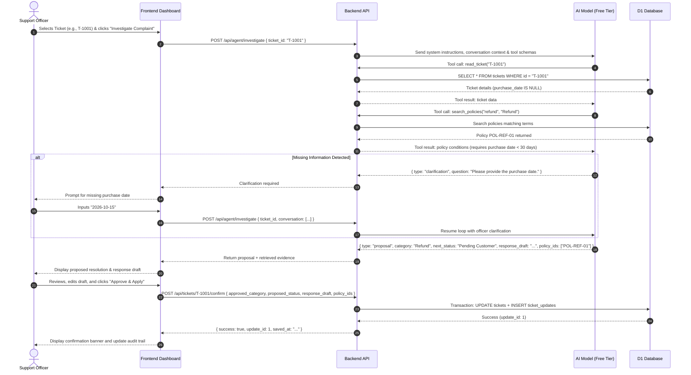

# System Architecture: AI Customer Support Resolution Agent

## 1. Executive Summary & Purpose
The **AI Customer Support Resolution Agent** is an internal enterprise-grade web application built for university hackathon demonstration. It empowers customer support officers to investigate fictitious customer complaints, evaluate them against a structured policy database, ask clarification questions when vital information is missing, generate policy-grounded resolution proposals, and persist updates only after explicit human approval.

---

## 2. Architecture Overview

```mermaid
graph TD
    User([Customer Support Officer]) -->|Interacts with UI| Frontend[React + TypeScript + Vite Dashboard]
    Frontend -->|REST API over HTTPS / JSON| Backend[Hono + TypeScript / Cloudflare Workers API]
    
    subgraph "Backend Core"
        Backend --> Router[REST Endpoint Router]
        Router --> AgentController[AI Agent Workflow Controller]
        AgentController --> PolicyEngine[Policy Search & Retrieval]
        AgentController --> AgentLoop[Bounded Tool-Calling Loop]
        AgentLoop --> Tool_ReadTicket[Tool A: read_ticket]
        AgentLoop --> Tool_SearchPolicies[Tool B: search_policies]
        Router --> Tool_UpdateTicket[Tool C: update_ticket (Guarded by User Approval)]
    end

    subgraph "External AI Services (Free Tier)"
        AgentLoop <-->|Function Calling & Reasoning| Gemini[Google Gemini 2.5 Flash / Groq Llama 3.3]
    end

    subgraph "Persistent Storage"
        Tool_ReadTicket <-->|SQL Queries| DB[(Cloudflare D1 / SQLite Database)]
        Tool_SearchPolicies <-->|Keyword Search| DB
        Tool_UpdateTicket <-->|Atomic Transactions| DB
    end
```

---

## 3. Component Details

### 3.1 Frontend (`frontend/`)
- **Technology**: React 19, TypeScript, Vite.
- **Styling**: Modern Vanilla CSS design system with custom tokens, sleek dark/light mode accents, glassmorphic panels, and responsive layout.
- **Key Views & Components**:
  - `TicketList`: Displays synthetic demo tickets with status badges, customer name, and category.
  - `InvestigationPanel`: Central workspace showing ticket metadata, complaint details, and investigation controls.
  - `AgentWorkflowTracker`: Real-time visual stepper indicating the agent's current stage (Reading Ticket $\to$ Searching Policies $\to$ Assessing Completeness $\to$ Proposing Resolution $\to$ Awaiting Approval $\to$ Saved).
  - `PolicyEvidenceViewer`: Transparent inspection panel showing policy IDs, titles, and exact matching clauses.
  - `ClarificationPrompt`: Interactive dialog when missing information (such as purchase date) must be supplied.
  - `ResolutionEditor`: Editable proposal draft, recommended next status, and assigned category.
  - `ApprovalModal`: Explicit confirmation interface preventing unauthorized or automated database writes.
  - `AuditHistory`: Inspects previous ticket updates and allows reopening historical records.

### 3.2 Backend (`backend/`)
- **Technology**: Cloudflare Workers / Hono running TypeScript.
- **REST API Endpoints**:
  - `GET /api/health`: Health status and database connectivity check.
  - `GET /api/tickets`: Retrieve all demo tickets.
  - `GET /api/tickets/:id`: Retrieve single ticket with validation.
  - `GET /api/policies`: Retrieve available policy records.
  - `POST /api/agent/investigate`: Execute bounded AI agent workflow for a ticket.
  - `POST /api/tickets/:id/confirm`: Explicit human confirmation endpoint to execute `update_ticket`.
  - `GET /api/tickets/:id/updates`: Retrieve audit history for a specific ticket.
  - `GET /api/updates/:id`: Retrieve specific historical update record.

### 3.3 Persistent Database (`Cloudflare D1` / SQLite)
- **Tables**:
  - `tickets`: Holds customer name, fictional email, subject, description, category, status, purchase date, timestamps.
  - `policies`: Contains policy code (`POL-REFUND-01`, `POL-DELIVERY-01`, `POL-ACCOUNT-01`), title, category, policy text, applicable conditions.
  - `ticket_updates`: Stores audit records of approved changes, including previous/proposed statuses, response draft, and cited policy IDs.

### 3.4 AI Integration & Function Calling
- **Provider**: Google Gemini API (`gemini-2.5-flash` / `gemini-1.5-flash`) or Groq (`llama-3.3-70b-versatile`) on eligible free tiers.
- **Bounded Loop**: Strictly capped at 5 tool calls and 6 model turns to eliminate runaway execution.
- **Tool Protocol**:
  1. `read_ticket(ticket_id)`: Fetches complaint and checks for completeness.
  2. `search_policies(query, category)`: Fetches relevant clauses and terms.
  3. `update_ticket(...)`: Server-side guarded write function, callable **only** upon explicit user confirmation.

---

## 4. End-to-End Workflow & Data Flow



---

## 5. Security & Safety Principles
1. **Zero Secret Exposure**: Model API keys and database credentials reside exclusively in server-side environment secrets. No API keys exist in frontend source or public repositories.
2. **Human-in-the-Loop Principle**: The AI agent **never** commits data updates autonomously. The `update_ticket` tool is strictly triggered via a separate explicit HTTP POST from the human officer.
3. **Prompt Injection Defense**: All user complaints and database records are treated strictly as data payloads with defensive system prompts.
4. **Synthetic Data Only**: All demo names, emails, and transaction details are completely fictional.
