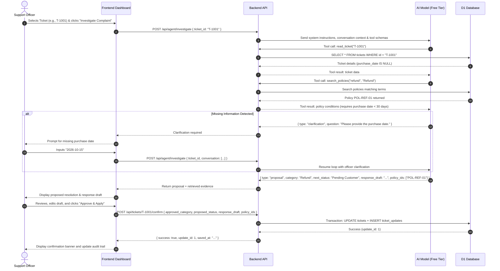

# System Architecture: AI Customer Support Resolution Agent

## 1. Executive Summary & Purpose
The **AI Customer Support Resolution Agent** is an internal enterprise-grade web application built for university hackathon demonstration. It empowers customer support officers to investigate fictitious customer complaints, evaluate them against a structured policy database, ask clarification questions when vital information is missing, generate policy-grounded resolution proposals, and persist updates only after explicit human approval.

---

## 2. Architecture Overview

```mermaid
graph TD
    User([Customer Support Officer]) -->|Interacts with UI| Frontend[React + TypeScript + Vite Dashboard]
    Frontend -->|REST API over HTTPS / JSON| Backend[Hono + TypeScript / Cloudflare Workers API]
    
    subgraph "Backend Core"
        Backend --> Router[REST Endpoint Router]
        Router --> AgentController[AI Agent Workflow Controller]
        AgentController --> PolicyEngine[Policy Search & Retrieval]
        AgentController --> AgentLoop[Bounded Tool-Calling Loop]
        AgentLoop --> Tool_ReadTicket[Tool A: read_ticket]
        AgentLoop --> Tool_SearchPolicies[Tool B: search_policies]
        Router --> Tool_UpdateTicket[Tool C: update_ticket (Guarded by User Approval)]
    end

    subgraph "External AI Services (Free Tier)"
        AgentLoop <-->|Function Calling & Reasoning| Gemini[Google Gemini 2.5 Flash / Groq Llama 3.3]
    end

    subgraph "Persistent Storage"
        Tool_ReadTicket <-->|SQL Queries| DB[(Cloudflare D1 / SQLite Database)]
        Tool_SearchPolicies <-->|Keyword Search| DB
        Tool_UpdateTicket <-->|Atomic Transactions| DB
    end
```

---

## 3. Component Details

### 3.1 Frontend (`frontend/` - Member 1: LUCY CSR)
- **Technology**: React 19, Vite, Lucide Icons.
- **Design**: Member 1's approved "LUCY CSR" dashboard with butter/indigo accents, crisp typography, and mobile-responsive layout.
- **Key Views & Components**:
  - `InboxPage`: Displays support tickets (T-001..T-005) with status filters, search, AI model status pill, and "+ New Ticket" modal.
  - `InvestigationPage`: Central workspace with `InvestigationTimeline` progress stepper, `TicketOverviewCard`, `AgentActivityFeed`, `PolicyEvidenceViewer`, `ClarificationForm`, and `ProposalReviewSection`.
  - `OutboxPage`: Internal outbox displaying archived resolution records with a one-click "Reopen in Workspace" capability.
  - `NewTicketModal`: Interactive form to submit new judge complaints with client and backend validation.

### 3.2 Backend (`backend/` - Lead Engineer & Team)
- **Technology**: Cloudflare Workers / Hono running TypeScript; local SQLite (`node:sqlite`) and remote Cloudflare D1.
- **Unified REST API Endpoints**:
  - `GET /api/health` and `/health`: Database connectivity and AI provider/model inspection.
  - `GET /api/tickets`: Retrieve all support tickets.
  - `GET /api/tickets/:id`: Retrieve single ticket with computed day elapsed counts.
  - `POST /api/tickets`: Create fresh ticket with length and date validation.
  - `GET /api/policies`: Retrieve available policy records.
  - `POST /api/tickets/:id/investigate`: Execute bounded AI agent workflow (rate limited).
  - `POST /api/tickets/:id/clarify`: Submit human clarification response to resume investigation.
  - `POST /api/tickets/:id/approve` and `POST /:id/confirm`: Enforce human confirmation gate before saving.
  - `GET /api/outbox` and `GET /api/updates/:id`: Retrieve archived resolution records.

### 3.3 Persistent Storage & Reference Data
- **Demo Reference Date**: Anchor date is strictly `2026-10-24`.
- **Database Tables**:
  - `tickets`: Holds customer name, fictional email, subject, description, category, status, purchase_date, shipping_date.
  - `policies`: Contains 3 corporate policies: `POL-REFUND-01` (14-day refund window), `POL-DELIVERY-01` (10 business days threshold), and `POL-ACCOUNT-01` (account lockout & password reset link).
  - `ticket_updates`: Audit outbox table storing approved resolution drafts, status transitions, and supporting policy citations.

### 3.4 Team Responsibilities
- **Member 1 (Frontend)**: Designed and implemented the approved "LUCY CSR" React dashboard and UI components.
- **Member 2 (Backend Exploration)**: Researched and prototyped early Express/MongoDB models; reviewed and consolidated onto Cloudflare D1/SQLite for serverless zero-dependency execution.
- **Member 3 (AI Agent & Prompting)**: Formulated system instructions, tool calling parameters, and Gemini/Groq provider integration.
- **Member 4 (QA & Test Suite)**: Developed the 25-case automated Vitest suite, business day tests, and error-path coverage.
- **Member 5 & Lead Engineer (Integration & Deployment)**: Architected end-to-end integration, deterministic key loader, Cloudflare Workers/Pages deployment runbooks, and submission documentation.
- **Bounded Loop**: Strictly capped at 5 tool calls and 6 model turns to eliminate runaway execution.
- **Tool Protocol**:
  1. `read_ticket(ticket_id)`: Fetches complaint and checks for completeness.
  2. `search_policies(query, category)`: Fetches relevant clauses and terms.
  3. `update_ticket(...)`: Server-side guarded write function, callable **only** upon explicit user confirmation.

---

## 4. End-to-End Workflow & Data Flow



---

## 5. Security & Safety Principles
1. **Zero Secret Exposure**: Model API keys and database credentials reside exclusively in server-side environment secrets. No API keys exist in frontend source or public repositories.
2. **Human-in-the-Loop Principle**: The AI agent **never** commits data updates autonomously. The `update_ticket` tool is strictly triggered via a separate explicit HTTP POST from the human officer.
3. **Prompt Injection Defense**: All user complaints and database records are treated strictly as data payloads with defensive system prompts.
4. **Synthetic Data Only**: All demo names, emails, and transaction details are completely fictional.
